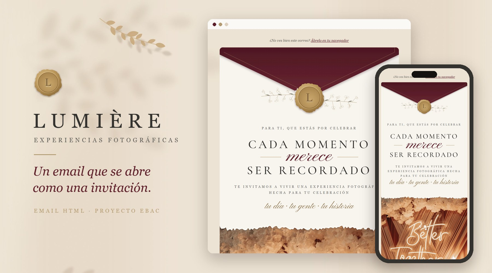
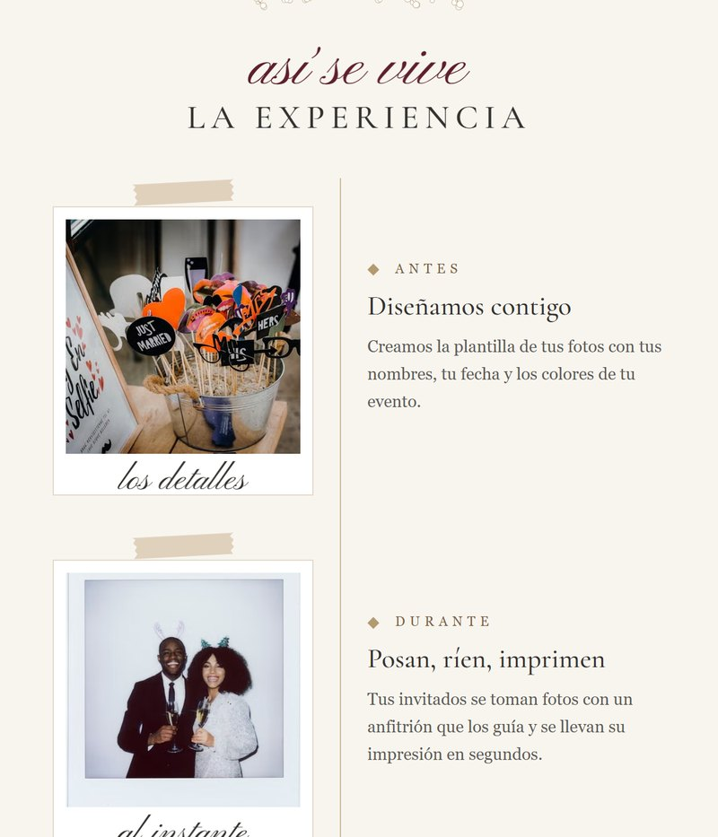
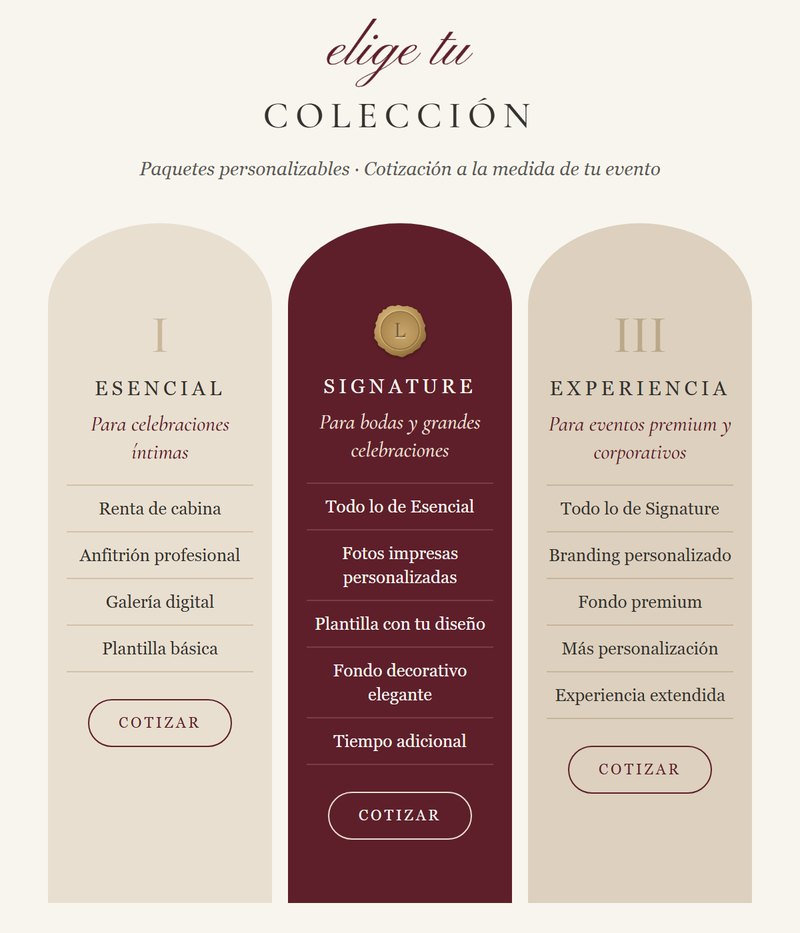
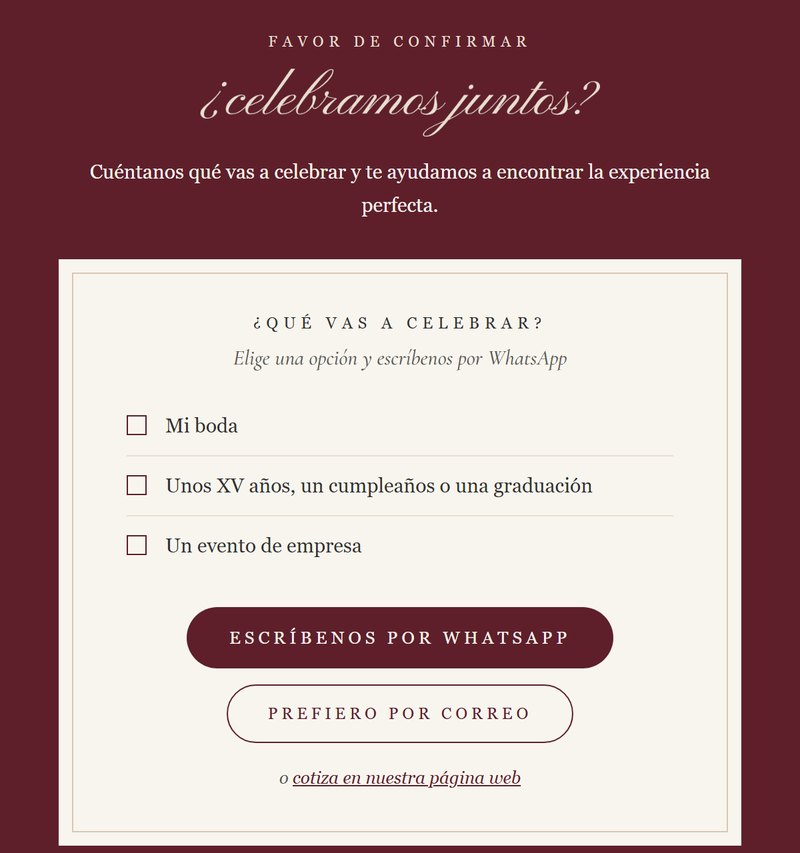
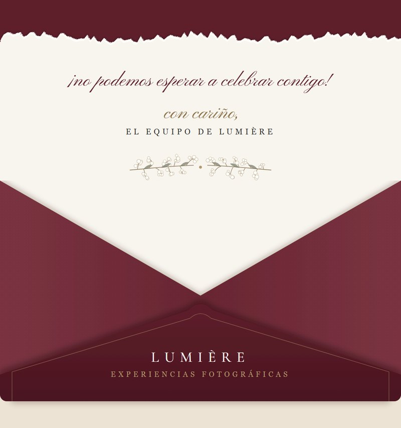
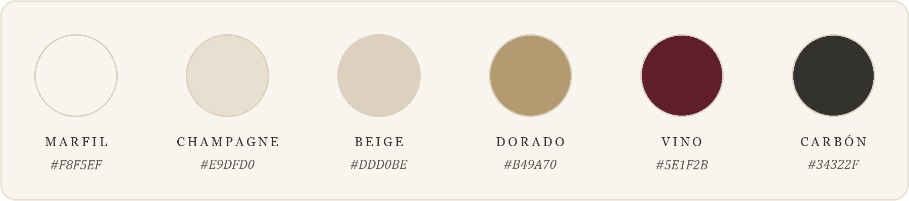

  

 

***Cada momento merece ser recordado.***

 

## La idea

**LUMIÈRE** renta cabinas de fotos para bodas, XV años y eventos de empresa.
Su email no podía sentirse como publicidad: tenía que sentirse como **recibir una invitación**.

Empieza con un sobre sellado con lacre, se despliega en una carta llena de detalles hechos a mano y, al final, vuelve a guardarse en el sobre con la firma de la marca.

## Lo que lo hace especial

- **Se abre como un sobre**: sello de lacre dorado, ramitas de flores y una carta que sale del sobre.
- **Se siente hecho a mano**: letra manuscrita, papel rasgado y polaroids con cinta washi.
- **Cuenta una historia**: el antes, el durante y el después de cada evento.
- **"Favor de confirmar"**: una tarjeta cuyas casillas abren WhatsApp con el mensaje ya escrito.
- **Luce igual de bien en el celular.**
- **Pensado para todos**: textos alternativos y colores fáciles de leer.

## Un recorrido por la invitación

<table>
  <tr>
    <td width="50%" align="center">
      
       <b>Así se vive</b>
       La experiencia, contada en polaroids
    </td>
    <td width="50%" align="center">
      
       <b>Elige tu colección</b>
       Tres paquetes en tarjetas con arco
    </td>
  </tr>
  <tr>
    <td width="50%" align="center">
      
       <b>Favor de confirmar</b>
       Elige tu evento y escribe por WhatsApp
    </td>
    <td width="50%" align="center">
      
       <b>Hasta pronto</b>
       La carta vuelve al sobre
    </td>
  </tr>
</table>

## Paleta y tipografía

**Cormorant Garamond** para los títulos y **Pinyon Script** para la letra manuscrita.

## Inspiración

Las invitaciones de boda: sobres color vino con sello dorado, nombres en mayúsculas con una palabra manuscrita al centro, la historia de la pareja en polaroids y la clásica tarjeta de *"favor de confirmar"*.

## Míralo tú mismo

1. Descarga el proyecto con **Code → Download ZIP**.
2. Abre `index.html` en tu navegador.

¿Quieres enviarlo como campaña o adaptarlo a tu marca? Todo está en la **[guía de uso](GUIA.md)**.

---

Proyecto académico para <b>EBAC · Desarrollo Front End</b> · LUMIÈRE es una marca ficticia. 
Fotos de <a href="https://www.pexels.com">Pexels</a>.

